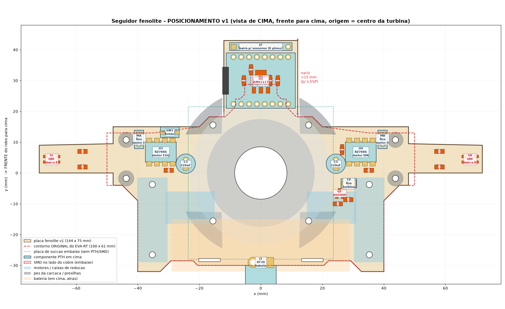
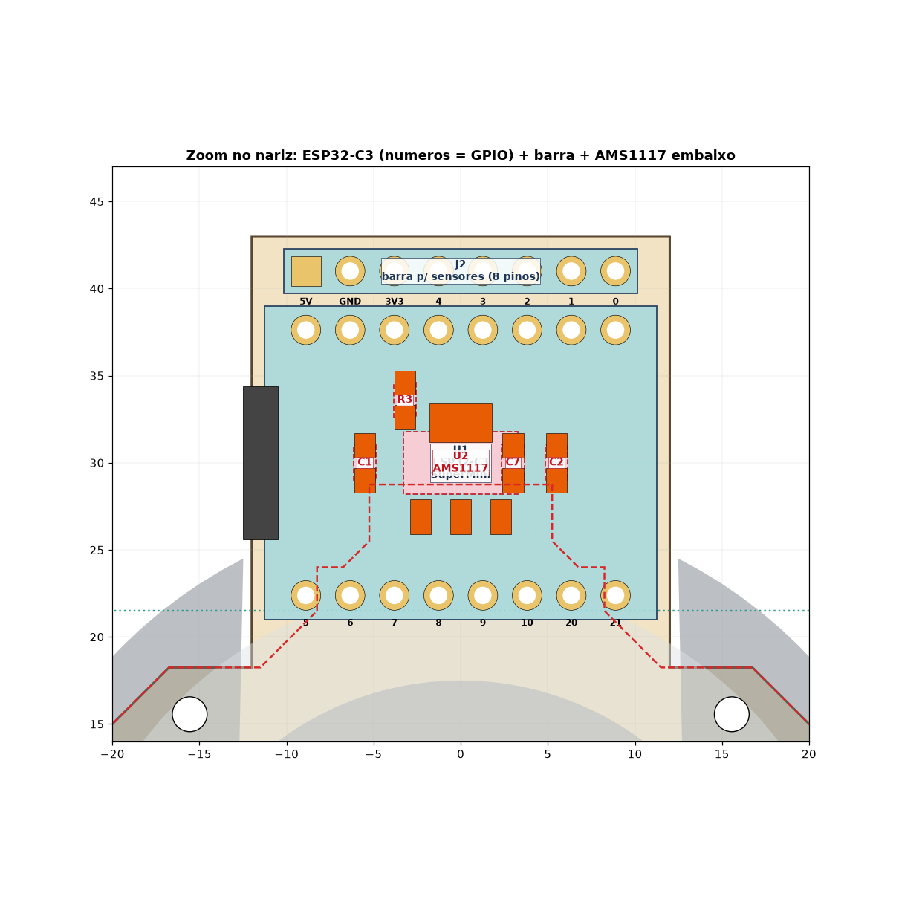

# Seguidor fenolite — posicionamento v1 (para aprovação)

Placa base do seguidor em fenolite face simples, baseada no EVA-RT. Ainda **não roteada**: falta aprovar o posicionamento e o mapa de pinos.

## Resumo
- Placa de **144 × 75 mm** contando os braços dos sensores de marca. O corpo principal fica ≈ ao do EVA-RT (100 × 61).
- O que cresce:
  - **Nariz central** de 24 mm de largura e +15 mm de comprimento, para o ESP32-C3 (pinos PTH não podem ficar sobre a placa de sucção).
  - Faixas laterais com +2 mm na frente.
- Origem no centro da turbina, +y = frente, vista de cima.
- Furos da turbina, da carcaça, das caixas, das presilhas e os rasgos da bateria nas posições exatas do EVA-RT (conferidas no Gerber).
- Checagem automática sem colisões:
  - Mecânica: pés e hélice da carcaça, motores, caixas, bateria e presilhas.
  - Elétrica: folga ≥ 0,6 mm entre pads de redes diferentes.

Tabela de posições, mapa de pinos e netlist em [`MAPA_PINOS.txt`](MAPA_PINOS.txt).

## Decisões pendentes
1. Aprovar o posicionamento.
2. Passar S0–S3 para IO0–IO3, para as trilhas irem retas até a barra (cerca de −4 jumpers). Com isso, os sensores de marca passam a ser lidos como digitais.
3. Manter face simples.
