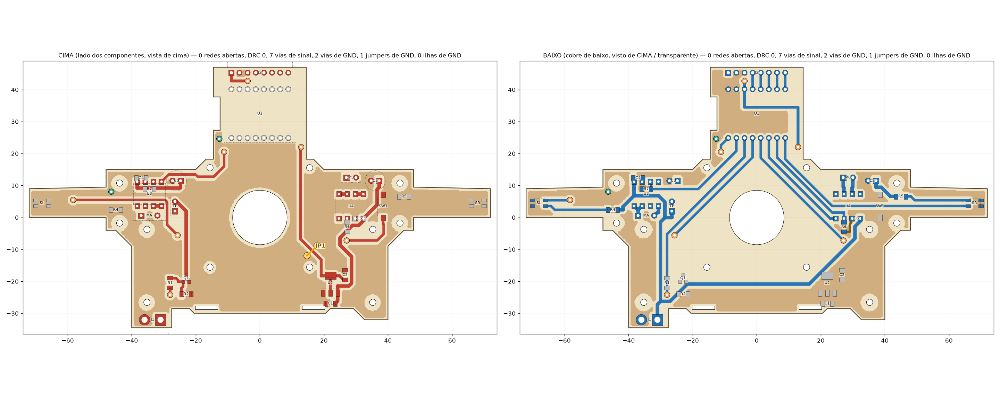
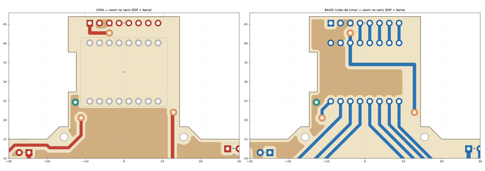
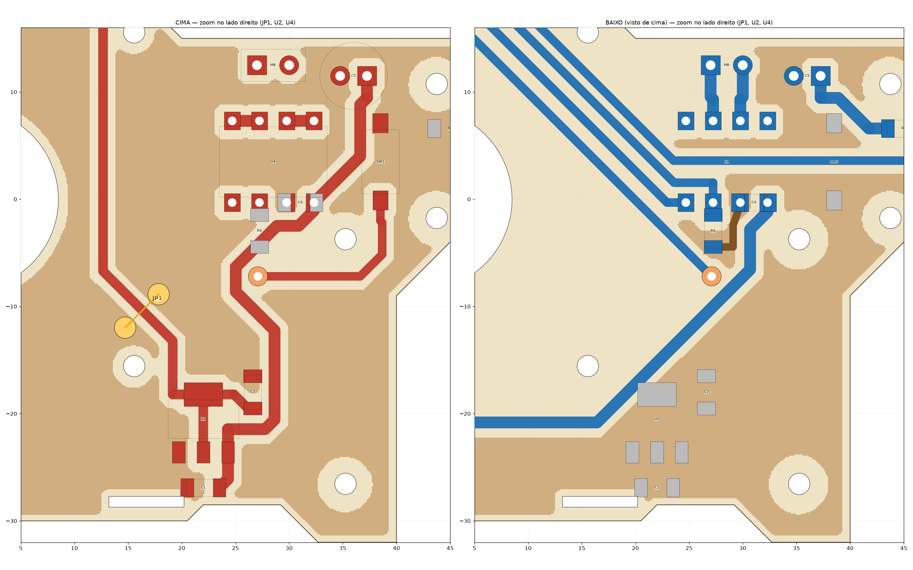

# Seguidor fenolite — v3 roteada (dupla face)

Placa base do seguidor em fenolite **dupla face**, no estilo do EVA-RT, com o posicionamento que o Erick fez no editor mais uma arrumação. **Roteada e conferida:**
- 0 redes abertas;
- DRC 0 (trilha ≥ 0,7 mm, folga ≥ 0,6 mm, inclusive até a borda);
- plano de GND nas duas faces, **sem ilhas**.

Zoom no nariz (ESP + barra) e no lado direito (JP1):

Cores: vermelho = cobre de cima; azul = cobre de baixo; marrom-claro = plano de GND; laranja = via de sinal; verde = via de GND; amarelo = jumper. A vista de baixo está desenhada **como vista de cima** (transparente).

## Números
- **Placa:** 144 × 81,5 mm. Cabe na fenolite de 10 × 15 cm.
- **Trilhas:**
  - sinais: 0,8 mm;
  - potência (VBAT, motores, turbina): 1,1 mm;
  - 3V3: 0,9 mm;
  - uma trilha curta de GND de 0,7 mm (R6).
- **9 vias** (fio soldado nas duas faces; furo 0,8 mm, ilha Ø1,8 mm):
  - 7 de sinal: 3V3 ×2, BI_A, BTN, GATE_D, MK_L ×2;
  - 2 de GND.
- **1 jumper de fio.**

## Jumper e vias de GND
| | Onde (mm) | Por quê |
|---|---|---|
| **JP1** (fio de 4,4 mm, por cima) | de (17,84; −8,86) a (14,72; −11,98), na ponta de dentro do motor direito | A trilha de 3V3 desce do nariz até o AMS1117 pela face de cima e corta o plano de cima de ponta a ponta. Embaixo, o GND da direita fica preso entre as trilhas que saem do ESP e a de VBAT. O JP1 passa por cima da 3V3 e liga o GND da direita ao principal: U4, C5, C6, R6, SW1, C2 e o sensor SR. As duas pontas são pontos de solda no próprio plano de cima, sem furo. O fio é baixo e cabe nos ~3,4 mm sob o motor. |
| Via de GND | (−46,36; 8,06) | Liga o GND do braço esquerdo (sensor SL) ao plano. |
| Via de GND | (−12,64; 24,62), ao lado do ESP | Liga o GND do nariz (ESP e barra) ao plano de cima. |

Para fechar o GND sem mais jumpers, fiz três ajustes à mão:
- **Via de BI_A baixada 0,74 mm** (de y 21,29 para 20,55). A ilha da via continua 0,5 mm fora da placa de sucção. Isso abriu uma faixa de GND entre a via e o ESP e eliminou um segundo jumper no nariz.
- **Trilha curta de GND embaixo** (0,7 mm), do R6.2 ao C6/U4.3.
- **Retirei os pedaços de cobre que ficariam soltos.** O maior é o triângulo embaixo da turbina: fica cercado pelas trilhas do ESP, e a placa de sucção não deixa pôr via ali.

## Mudanças de circuito desde a v2 (conferir)
- **Sensores de marca digitais.**
  - O LED é alimentado pelo VBAT com 470 Ω (R4/R5, na raiz dos braços).
  - Os pull-ups R8/R9 (47 k) saíram. No firmware, use `pinMode(..., INPUT_PULLUP)` no IO8 e no IO21.
- **Pull-downs de 10 k:**
  - R7 no FI_A (IO6), porque o IO6 tem pull-up no reset;
  - R6 no FI_B (IO20), pelo mesmo motivo.
- **Fileira de trás do ESP:**
  - IO5 = BI_A, IO6 = FI_A, IO7 = GATE_D (turbina), IO8 = MK_L;
  - IO9 = BTN, IO10 = BI_B, IO20 = FI_B, IO21 = MK_R.
  - A fileira da frente continua ligada reto na barra (C0, S3..S0 = IO4..IO0).
  - Detalhes em [`MAPA_PINOS.txt`](MAPA_PINOS.txt).
- **Drivers:** o U3 (RZ7886 esquerdo) está girado 270°, com os ilhós MA embaixo; o U4 fica a 90°, com MB em cima.
  - Eles não ficam espelhados porque o espelho de um DIP-8 inverte a ordem dos pinos, e nenhum chip real tem essa pinagem.
  - Escolhi, para cada lado, a orientação que roteia sem cruzar.
- **Nariz** alargado para ±14,5 mm, com recorte para o plugue USB-C entrar rente.

## Conferir antes de fabricar
- **XT30:**
  - polaridade: J1.1 = VBAT (pad quadrado), J1.2 = GND;
  - os pinos plásticos de fixação ficam fora da placa, então cole o conector.
- **Botão KFC-A06:** usei pads a ±3,6 mm do centro. Meça com o paquímetro.
- **AMS1117:** fica embaixo da ponta da bateria e esquenta um pouco a LiPo.
- **Trilhas de 1,1 mm** (VBAT, motores, turbina): estanhe para aguentar melhor a corrente da turbina.
- **Presilhas das varetas:** reimprimir com fenda de 1,6 mm (o EVA-RT usa placa de 1,0 mm).
- **Roda:** Ø22 mm, para manter ~2,4 mm de altura do chão com fenolite de 1,6 mm.
- **Gravação pelo botão BOOT:** o IO8 (MK_L) precisa estar em nível alto. Grave com o robô fora da faixa branca. Pela USB, normalmente nem precisa do botão.

## Arquivos
- [`TABELA_EASYEDA_v3.md`](TABELA_EASYEDA_v3.md): tudo para redesenhar no EasyEDA Pro:
  - componentes (posição, rotação, face) e pads;
  - netlist, contorno e furos mecânicos;
  - vias, jumper e todas as trilhas, ponto a ponto.
- [`placa_v3_contorno.dxf`](placa_v3_contorno.dxf): contorno e furos mecânicos, para importar no EasyEDA Pro.
- [`resumo_v3.json`](resumo_v3.json): números da verificação.
- [`roteamento/`](roteamento): projeto e saída do Freerouting (`x2.dsn` / `x2.ses`). É a saída crua, sem os 3 ajustes à mão; a versão final está na tabela.
- [`codigo/`](codigo): scripts em Python. O `final_v3.py` gera plano, vias, jumper, DRC, imagens e tabela a partir do roteamento.
- [`NOTAS.md`](NOTAS.md): medições do EVA-RT e decisões.
- [`editor/editor_placa.html`](editor/editor_placa.html): editor de posicionamento (v2).
