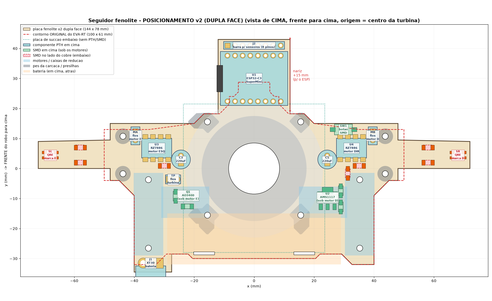
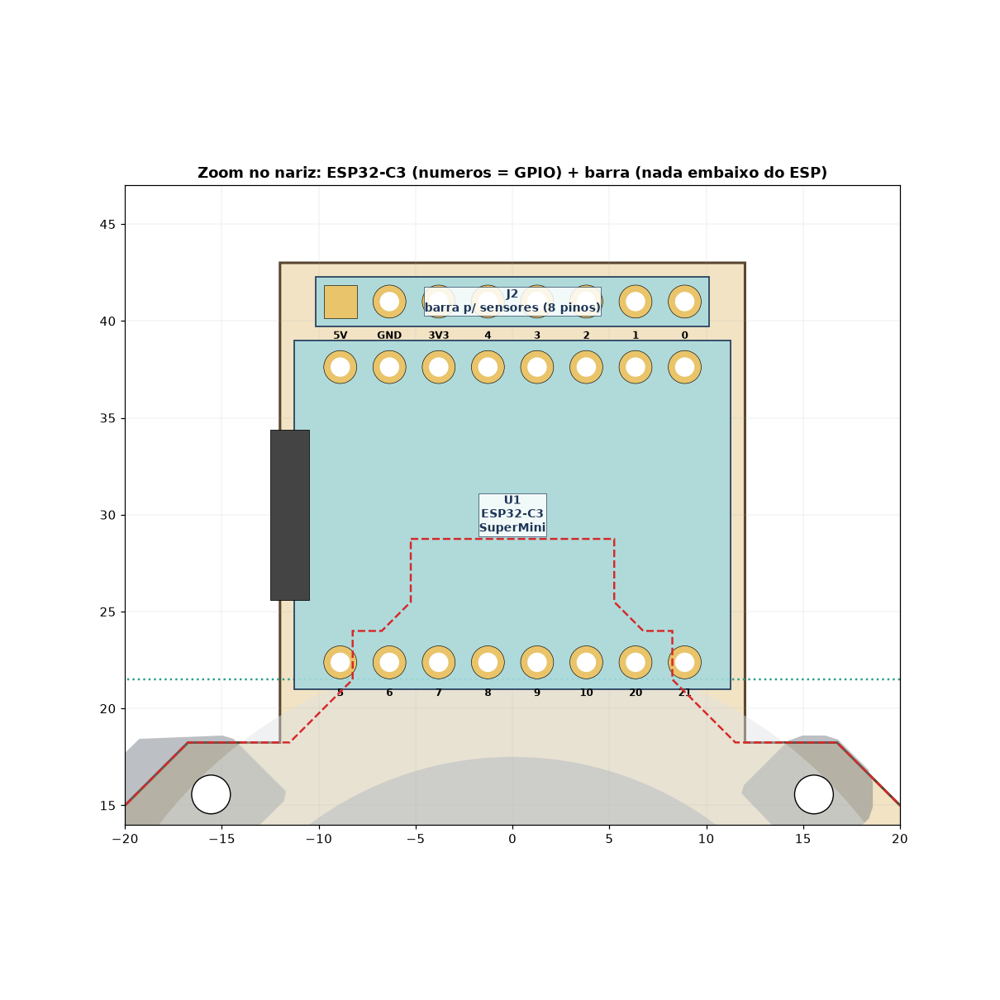

# Seguidor fenolite — posicionamento v2 (dupla face, para aprovação)

Placa base do seguidor em fenolite **dupla face**, baseada no EVA-RT. Ainda **não roteada**.

## O que mudou da v1
- **Dupla face.** A placa tem 144 × 77,5 mm e cabe na fenolite de 10 × 15 cm.
- **Nada embaixo do ESP.** O nariz leva só o ESP e a barra da frente.
- **SMD em cima, embaixo dos motores** (onde o EVA-RT põe os IFX). O motor fica a ~3,4 mm da placa.
  - Motor direito: AMS1117 + 10 µF + 22 µF.
  - Motor esquerdo: AO3400A + 220 Ω + 4,7 k da turbina.
- **XT30** no canto traseiro esquerdo, com a boca para trás. A bateria fica deitada atrás, como no EVA-RT.
- **Botão** KFC-A06 2 terminais (3×6×4,3 SMD), na faixa direita.
- **Mapa de pinos:** a fileira do ESP virada para a frente liga reto na barra (C0, S3..S0 = IO4..IO0). Os sensores de marca passam a ser digitais (IO8/IO21).

## Verificação
- Checagem automática **sem colisões**:
  - mecânica: pés reais da carcaça (STL), hélice Ø34, motores, caixas, bateria, presilhas e placa de sucção;
  - folga ≥ 0,6 mm entre pads de redes diferentes.
- Furos da turbina, da carcaça, das caixas, das presilhas e rasgos da bateria nas posições exatas do EVA-RT (Gerber).

Tabela de posições, mapa de pinos e netlist: [`MAPA_PINOS.txt`](MAPA_PINOS.txt). Raciocínio e medições: [`NOTAS.md`](NOTAS.md).
